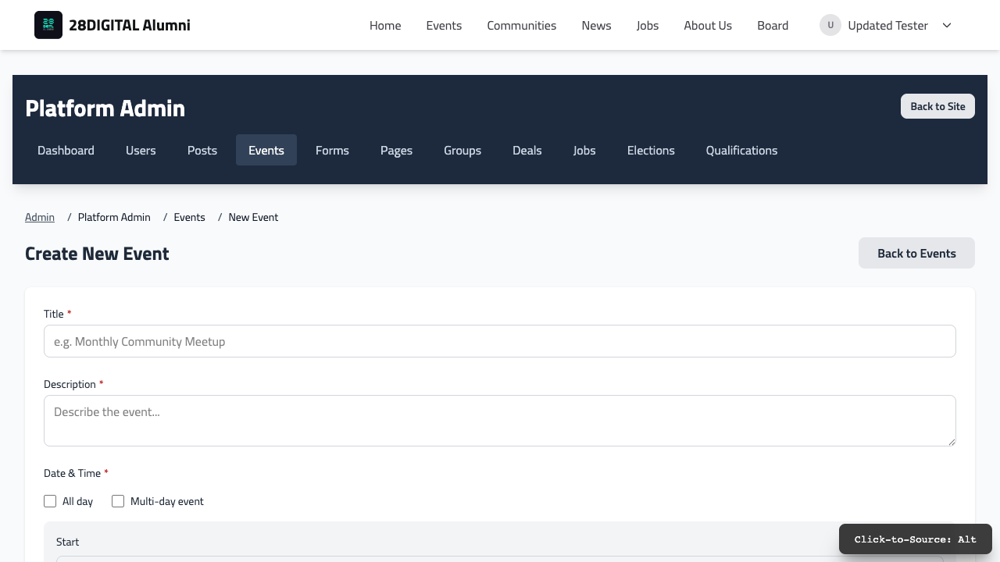

# Admin guide

A tour of everything manageable in the admin area. See [Roles &
Permissions](./roles-and-permissions.md) for who can see what. Every group
has its own admin area (`/admin/<group>`, e.g. `/admin/germany.berlin`;
`/admin/root` for the whole site); `/admin` opens the highest group you
manage, and the "Switch group" menu jumps between the groups you manage.

The admin area deliberately looks the same on every deployment of this
platform, regardless of the public site's branding, so this guide applies
no matter which community or organization you're managing.

*The admin menu of the whole site: Dashboard, Users, Notes, Articles, Events,
Forms, Pages, Groups, Deals, Jobs, Elections, Qualifications. A chapter's admin
shows Dashboard, Members, Notes, Articles, Events, Forms, Pages, Deals, Jobs,
Elections and Group settings, limited to that chapter and the groups below it.*

## Content

- **Notes** — short news of the site or a group ("Doors open at 18:00"): text and
  links only, at most 1000 characters, no title and no image. Write one in the quick
  form at the top of the Notes list. Anything longer is an article.
- **Articles** — long-form news with a title, an optional featured image (shown on
  the article, its card and the hero block, and when the article is shared) and full
  formatted text. Create them under Articles → New article.
- Notes and articles appear together, newest first, in the news (the **Stream**
  page block, a group's page, the archive at `/archive/all`). A Stream block can also
  show notes only (a "short stream") or articles only; the archive has
  `/archive/notes` and `/archive/articles`. Both can be *about* an item (pick it
  under "About" when editing), such as an event: they then also show under it.
- **Event updates** — on an event's admin page, the **Updates** tab has *Write note*
  (e.g. "Doors open at 18:00") and *Write article* (the announcement, the recap).
  They show under the event on its page, newest first.
- **Pages** — full pages (like the homepage, "About Us," or a community's
  landing page) built with a visual, drag-and-drop page builder out of
  reusable content blocks (a hero banner, an events list, a text section,
  and so on). Every group has its own pages, served under its address
  (`/germany/berlin/about`); listing blocks on them show that group's
  content. The site menus are managed on the top level only.
- **Links and addresses** — every event, note, article, job, deal and election has one
  address under the group that owns it (`/germany/berlin/events/summer-bbq`);
  the same item opened under another address is forwarded there. Links you
  pick in a menu, a page block's link field or the "Link the selected text"
  search above the text editor point at the item itself, not at its address:
  renaming or moving a group, or renaming a page, never breaks them, and a
  link to something that was deleted simply disappears (its text stays). In a
  menu's URL field you can also type a group as `root/germany/berlin` or its
  listing as `root/germany/berlin:events`.
- **Visibility** — notes, articles and events are *Public* (everyone; also listed on
  every group above), *Members* (members of the group and the groups below
  it) or *Representatives*. A group's pages list its own items, those of the
  groups above it (labelled with their source) and the public items of the
  groups below it.
- **Deals** — member discounts and perks listings.
- **Jobs** — the job board. Members can submit listings from the public
  site; they show up here as pending until an admin approves them.

## People

- **Users** — the member directory.
- **Groups / Group settings** — the group's name, description and page
  images, its sub-groups (create a region or chapter with a URL slug),
  deleting an empty group and, for platform admins, moving a group.
- **Members** (below the top) — the group's members, adding and removing
  them, and granting or revoking roles (see [Roles &
  Permissions](./roles-and-permissions.md)).
- **Tags** — freeform labels applied to members or content, which can also
  be assigned automatically (e.g. approving a qualification can assign a
  tag — see [Qualifications](./qualifications.md)).

## Events

The full event lifecycle — see [Event & Ticketing
Flow](./event-ticketing-flow.md) for a detailed, illustrated walkthrough.
Once an event exists, its management page has tabs for:

- **Details / Edit** — title, description, date & time, location, visibility
- **Products** — ticket types and how many are available (see the
  ticketing doc for how this works)
- **Participation** — who's RSVP'd (separate from paid ticket sales)
- **Tickets / Scan** — issued tickets, and the QR check-in scanner for the door
- **Comp Tickets** — issue free tickets directly, without going through checkout
- **Transactions** — payment records
- **Photos** — the event's photo gallery

## Governance

- **Elections** — community leadership election cycles. Create a cycle,
  then add the positions members can apply for.

## Forms

A generic form builder for anything that collects structured answers from
a member — onboarding surveys, event feedback, and so on. Each form's
responses can be viewed and exported. The built-in onboarding form is a
form like any other; its answers also show up, nicely formatted, on a
member's own profile.

## Qualifications

See [Qualifications](./qualifications.md) for the full picture — in short,
this manages a membership-tier verification process: admin-defined
qualification types, member claims against them, an approve/reject review
queue, and QR codes for verifying someone in person. Always managed
platform-wide, even for a community representative.
