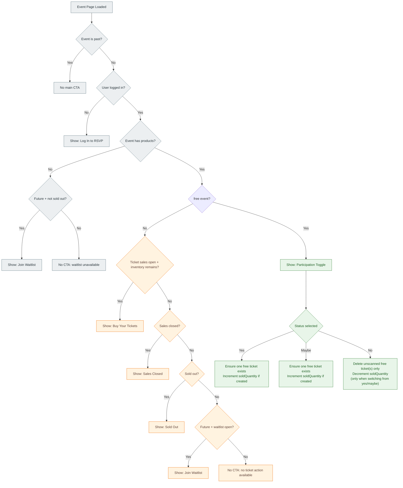

# Event CTA Flow

This document captures the CTA decision logic for the event detail page, including both free and paid ticket branches.

## Event Participation Flow



## Notes

- Paid tickets are never removed by RSVP status changes.
- Free RSVP removal path only deletes tickets tied to free transactions (`free_*`) and only if unscanned.
- Capacity is represented via `soldQuantity` and is adjusted in this free RSVP lifecycle.

## Ticket buying flow

This flow starts after pressing `Buy Your Tickets` and covers the paid checkout route end-to-end.

```mermaid
flowchart TD
  A[Press: Buy Your Tickets] --> B[Open checkout page]
  B --> B1{Event requirements pending? food preference, photo consent}
  B1 -->|Yes| B2[Answer each step, saved once per user]
  B2 --> C
  B1 -->|No| C[Load inventory groups and products]
  C --> D{Group sales open and group capacity > 0?}
  D -->|No| D1[Group not selectable: Sold Out / Sales Closed / Not Yet Open]
  D -->|Yes| E{Product quantity available?}
  E -->|No| E1[Product hidden from selectable list]
  E -->|Yes| F[Select one product per inventory group]
  F --> G[Proceed to participants and payment step]
  G --> L[Complete Payment: requirements checked again; pending order + core payment from DB prices]

  L --> M[Pay on the provider's checkout page (Stripe Checkout)]
  M --> N[Signed webhook /api/payments/webhook/stripe marks the payment paid; the events onPaid handler runs]
  N --> O[Create tickets for purchased products]
  O --> P[Increment soldQuantity for purchased products]
  P --> Q[Auto-upgrade participation maybe → yes if tickets were created]
  Q --> R[Send confirmation email and ticket QR codes]
  R --> S[Show Payment Successful and View My Tickets]

  classDef step fill:#e3f2fd,stroke:#1565c0,color:#0d47a1;
  class A,B,B1,B2,C,D,D1,E,E1,F,G,L,M,N,O,P,Q,R,S step;
```

## Notes on Purchase Flow

- Availability is filtered twice: first by inventory group (sales window + group capacity), then by product quantity.
- Checkout currently allows one selected product per inventory group.
- Food preference and photo consent are user requirements of the `event.checkout` context: the checkout and the RSVP ask them first, once per user (again only when their version is bumped), and the checkout/RSVP actions refuse while they are pending.
- Checkout validates inventory again on submit before creating the payment; amounts come from the product prices only.
- The provider's signed webhook is what finalizes paid ticket creation (core payments, `payments.tickets` handlers in `src/modules/events/payments.ts`); the buyer's return to the checkout page only shows the status core already has.
- A checkout not completed within `PAYMENTS_CHECKOUT_EXPIRY_MINUTES` expires (hourly core schedule) and its pending order is canceled. Checkouts hold no capacity.
- Without a payment provider configured, only free products are offered.
- Confirmation email sending happens after ticket creation and should not fail the purchase if email delivery fails.
