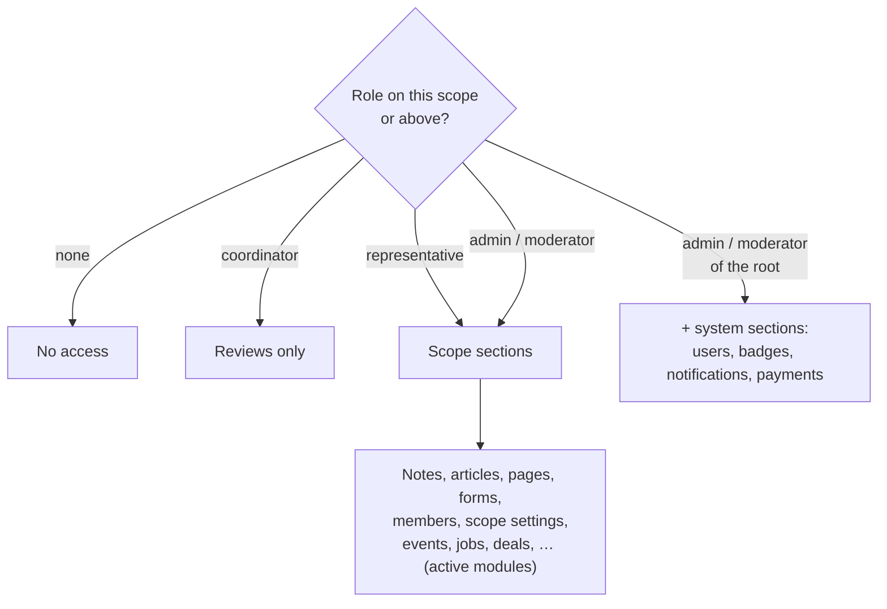

# Admin area

Every scope has its own admin area at `/admin/<scope>` (e.g. `/admin/germany.berlin`). What a person sees there depends on their role on that scope or above ([[scopes-and-roles]]).

## Rules
- A scope switcher moves between the scopes a person manages; managing a region includes its chapters.
- Everything shown is limited to the scope and the scopes below it. An item from another branch of the tree answers "not found", even by direct address.
- The **system sections** exist only on the root, for platform admins: users (with email addresses and membership tiers), badges, failed notifications and background jobs, payments.
- Modules add their sections; a module decides on which levels it appears (root only, all scopes, or certain kinds).
- The admin area always uses the built-in design; the theme does not apply.

## Decisions
- One admin area per scope instead of one global back office, so chapters manage themselves without seeing other chapters' data.
