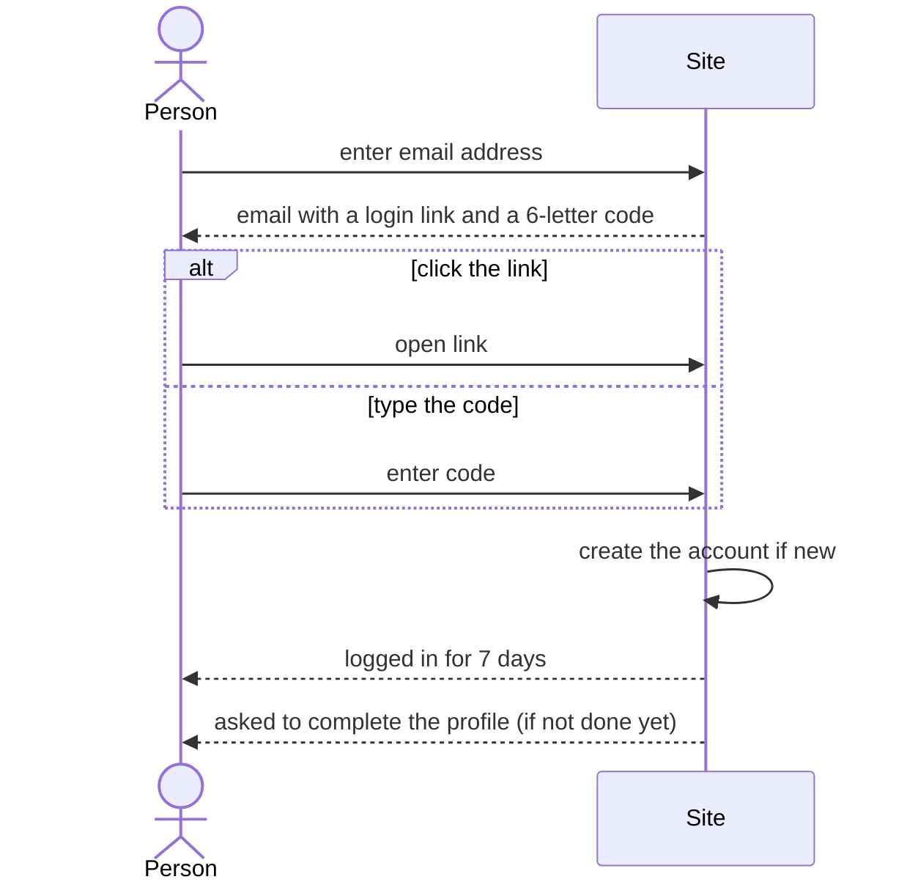

# Accounts and login

There are no passwords. People log in with their email address; the account is created the first time they log in.

## Rules
- The link and the code are valid for **15 minutes** and work **once**. A new request replaces the previous one.
- After **5 wrong codes** the code is blocked; the person requests a new email.
- At most 3 login emails per address per 15 minutes, and 10 per network address per hour, against abuse.
- A login lasts **7 days**.
- New accounts must complete their profile, location and (if one is set up) the onboarding survey before using the site ([[user-requirements]]).
- Nobody has a role by default; permissions come only from roles on scopes ([[scopes-and-roles]]).

## What others can see
- Other people only ever see a person's **public profile**: name, public thumbnail picture, badges ([[badges]]). Email address, location, year of birth, gender, food preference, photo consent and the full-size picture are private.
- The member search in pickers returns names and thumbnails only, so the member list can't be harvested for email addresses.
- Platform admins see email addresses in the users list; scope managers see members of their own scopes only.

## Decisions
- Email login instead of passwords: nothing to leak or reset, and every account has a verified address.
- Privacy is enforced where data is loaded, not where it is shown: pages about other people only ever receive the public profile.
