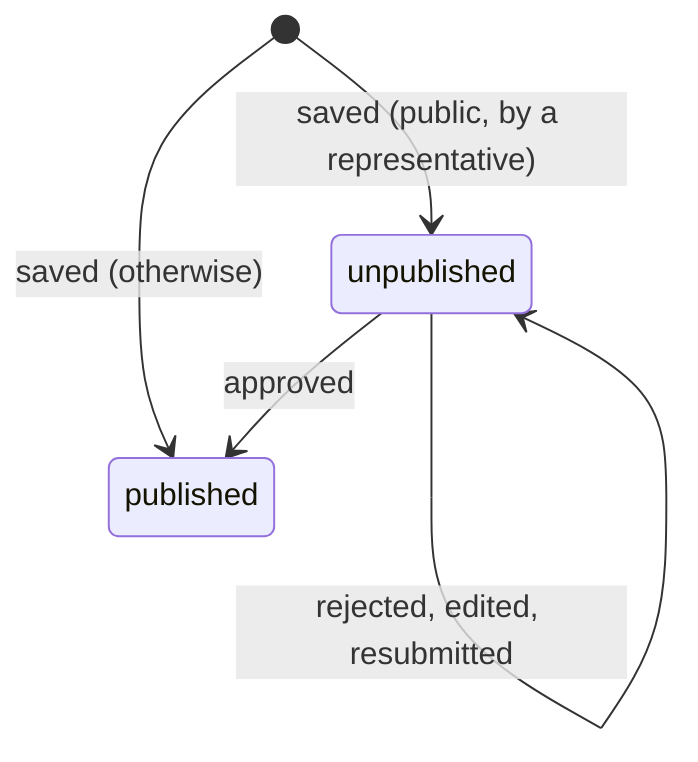

# Notes and articles

The two kinds of posts. Both belong to a scope, have a [[visibility]] and go through [[review-flow]] when public.

| | Note | Article |
|---|---|---|
| Length | Short: up to 1000 characters | Long |
| Title | none | required |
| Formatting | bold, italic, links | full rich text |
| Image | none | optional featured image |

## Rules
- Written in a scope's admin area by people with a role there.
- A note or article can be **about** something, e.g. an event: it then appears as an update on that event's page.
- Listings (news, a scope's home page, archives, updates about an event) mix both kinds, newest first, filtered by [[visibility]].
- Every post has one address under its scope ([[urls-and-pages]]). Links inside posts are stored as references, so they survive renames.
- Text is cleaned on saving: only safe formatting and links are kept.
- Public posts also appear in the site's feeds ([[social-web]]). When a public post is deleted or made non-public, a deletion marker is kept so followers' copies can be removed.

## Decisions
- 2026-10: two core types replace the old "posts" (#35, #121): short notes for quick updates, articles for long form. They are core, not a module, because events, reviews and the feeds all build on them.
- Updates about an event are ordinary notes and articles pointing to it (#118), not a separate kind of content.
