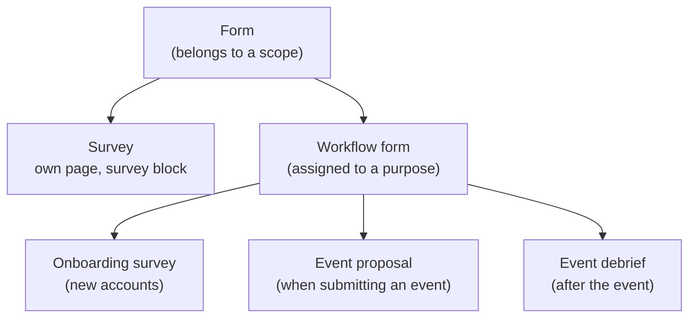

# Forms

Questionnaires built in the admin area with a visual form builder. They serve two purposes: **surveys** people fill in on the site, and **workflow forms** that a feature asks at a certain step.

## Rules
- **Which form is used for a purpose:** the one assigned at the nearest scope, going up the tree. A chapter can use its own proposal form, or inherit its region's or the site's.
- A form that has answers is **locked**: its questions can no longer change. Admins make an editable copy instead.
- Answers are checked on the server against the form's questions; free text is stored and shown as plain text.
- **Surveys:** a public survey can be answered without logging in, with an automatic anti-spam check; a private one needs a login. Each person answers once, unless the form allows changing answers.
- Workflow forms are only filled in inside their workflow (e.g. [[event-proposals]]), never on their own page.

## Decisions
- One form system for surveys and workflows, so admins build every questionnaire the same way.
- Locking answered forms keeps every answer next to the exact question it answered.
