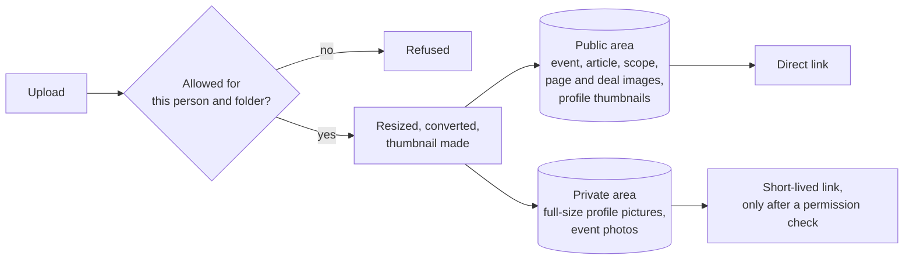

# Images and uploads

All images are stored in S3 storage, in a **public** or a **private** area.

## Rules
- Who may upload where: anyone logged in may upload their own profile picture; scope images, article images and page-builder images need a managing role on a scope; each module declares its own folders and the role they need (e.g. event photos need an admin). A switched-off module's folders accept nothing.
- Profile pictures are split: the small thumbnail is public (it shows next to the name), the full-size picture is private.
- Event photos are private and shown only to people checked in at that event ([[events]]).
- A stored image reference is always checked against the folder it must be in, so nobody can point a record at someone else's private file.

## Decisions
- Private files are never linked directly: every view gets a fresh link that expires quickly.
