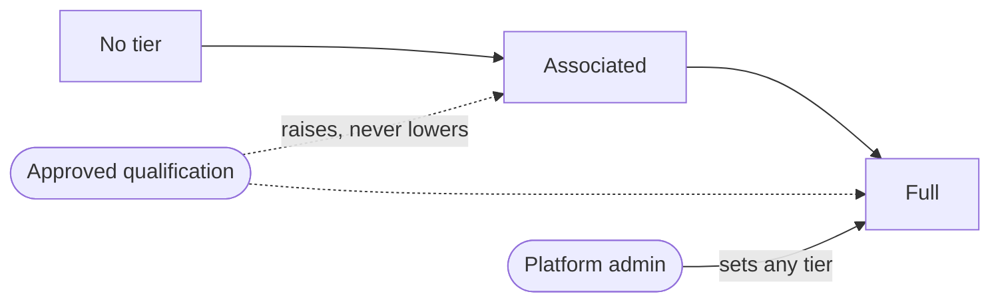

# Membership tiers

A person's formal membership of the organisation: **none**, **associated** or **full**. This is different from joining a chapter ([[scopes-and-roles]]), which anyone can do.

## Rules
- Platform admins set or remove a person's tier in the users list.
- An approved qualification can raise the tier automatically, never lower it ([[qualifications]]).
- "Full" includes everything "associated" allows.
- What a tier unlocks today: standing in elections that require a tier ([[elections]]).

## Decisions
- **Open:** a tier can carry an end date, but nothing checks it yet: an expired membership still counts.
