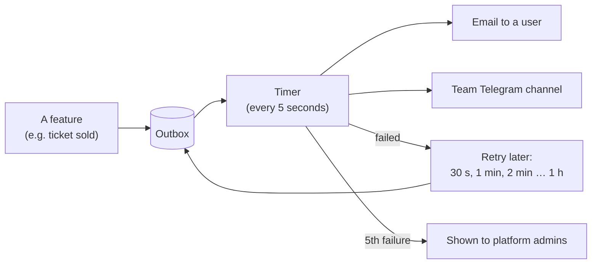

# Notifications

Every email and Telegram message goes through one system. A feature only says *"send notification X to Y"*; the message is written to an outbox in the database, and a timer in the server delivers it a few seconds later ([[background-jobs]]).

## Rules
- Every notification is declared once, with its channels and whether people may turn it off.
- Recipients are users (email) or the **team channel** on Telegram (e.g. the sale alert in [[ticket-checkout]]).
- Notifications people may turn off carry a one-click unsubscribe link; users manage them in their profile.
- The **login email is the only exception**: it is sent immediately, because the user is waiting for it.
- Platform admins see failed messages and can retry them.

## How it is stored
One outbox row per message (with its status and attempts), plus each user's choices for the notifications they may turn off.

## Decisions
- An outbox instead of sending immediately: a slow or broken mail server never breaks a page or a payment, and no message is lost when the server restarts.
