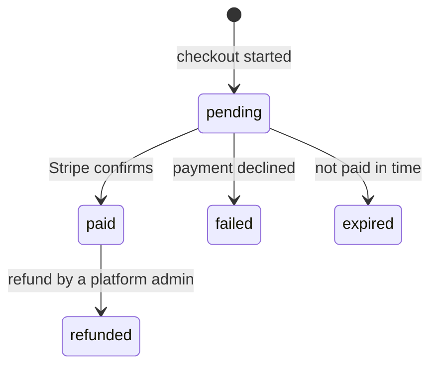

# Payments

One payment system for every feature, with Stripe Checkout as the provider. A feature says what is being bought and at what price; payments handles the rest and tells the feature when the status changes. Used by [[ticket-checkout]].

## Rules
- **Prices always come from the database**, never from what the browser sends.
- **Only Stripe's signed confirmation counts as paid.** A buyer landing on the "thank you" page proves nothing.
- A checkout is open for a limited time (default 60 minutes; Stripe gets the same deadline). An hourly job closes abandoned ones, first at Stripe so they can no longer be paid. A checkout the buyer already finished is left alone, including bank transfers (SEPA) whose money arrives days later.
- Every status change is passed to the owning feature exactly once, in the background, retried until it succeeds ([[background-jobs]]). This also happens when the feature has since been switched off, so no paid order is lost.
- The buyer gets a receipt by email ([[notifications]]).
- Without Stripe configured, payments are switched off and features offer free alternatives.
- Platform admins see all payments and can refund them in full.

## How it is stored
One record per payment (what, for whom, amount, status) pointing to the feature's own record (e.g. the ticket order), plus a log of every status change so none is applied twice.

## Decisions
- One shared payment system with hooks per feature, instead of payment code in every feature.
- Open: partial refunds (#124), subscriptions (#125).
