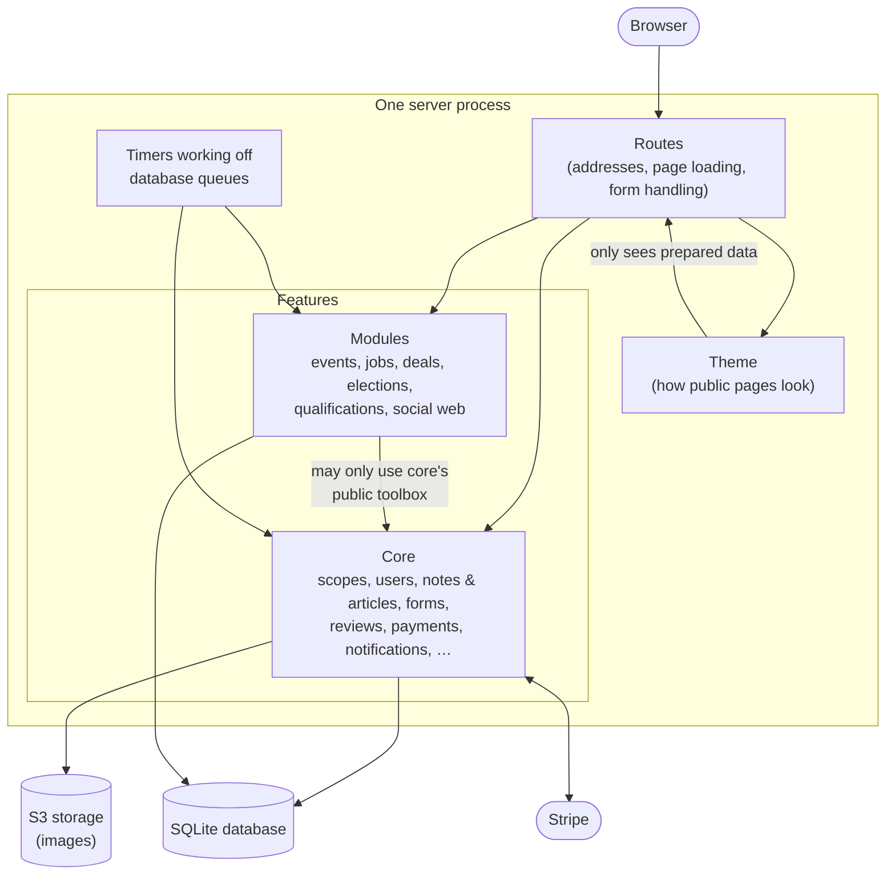
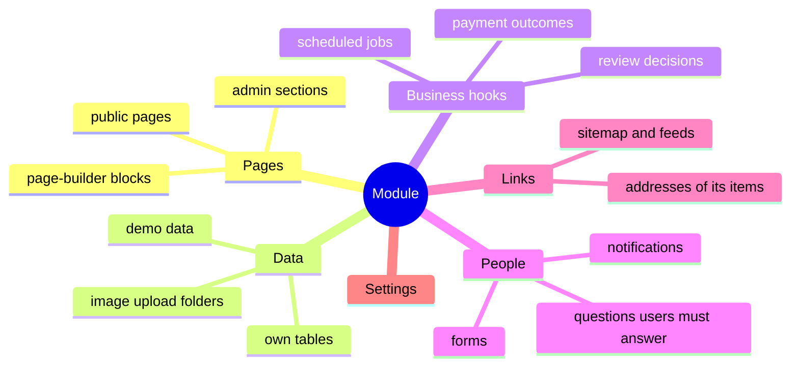

# Application structure

How the CMS is put together. It is one web application (Qwik, server-rendered, SQLite database) made of four layers.

## The layers
- **Core** is what every installation has: the scope tree and roles ([[scopes-and-roles]]), [[visibility]], users and login, notes and articles, pages, forms, [[review-flow]], [[payments]], [[notifications]], [[background-jobs]].
- **Modules** are optional features. Each one can be switched on or off per installation. A switched-off module disappears from the site (its pages answer "not found", its links and menus vanish), but its data stays, and payments or reviews already under way still finish.
- **Theme** decides how public pages look. It is licensed separately and never touches the database: it only receives data prepared for it. The admin area is not themeable.
- **Routes** connect an address to the code that loads the page or handles the form ([[urls-and-pages]]).

## What a module brings
A module describes itself in one manifest; core reads it and wires everything in.

## Rules
- Modules may only use core's public toolbox, never its internals; an automatic check enforces this.
- Only "service" code talks to the database. Pages and actions ask services, and services return only what the viewer may see. This is where privacy is enforced.
- All user-facing text comes from translation catalogs; one language per installation (English or German).
- Which modules are active and which language is used are fixed when the site is built; the server refuses to start with different settings.

## Decisions
- 2026-10: rewrite from one big application into a small core plus optional modules (#121), so installations can leave out what they don't need and features stay separate.
