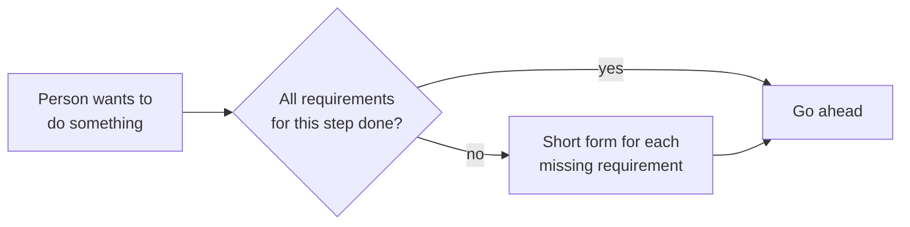

# User requirements

Things a person must fill in or agree to before they can do something: complete their profile before using the site, or state their food preference before buying a ticket. Each one is asked once and remembered.

## Which ones exist

| When | Requirement | Source |
|---|---|---|
| Using the site at all | Profile basics (name, year of birth, gender, picture) | core |
| Using the site at all | Location (city, country) | core |
| Using the site at all | Onboarding survey, **only while one is set up** ([[forms]]) | core |
| Buying a ticket / registering | Food preference, photo consent | [[ticket-checkout]] |

## Rules
- A person with a missing site-wide requirement is sent to the setup page first, and back to where they wanted to go afterwards.
- Answers are **private**. The person sees and changes their own in the profile; admins see them only where needed (organisers: the participant list of their event).
- When a requirement's questions change in a way that needs new answers, it gets a new version and **everyone is asked again**.
- A module's requirements apply only while the module is switched on.

## Decisions
- **Open:** after the setup steps, a new user sometimes lands on the home page instead of the page they wanted (seen locally, listed in #121).
- Requirements are stored separately from the account, so a new module can ask for something without changing the account itself, and the site knows which version each person agreed to (important for consent).
