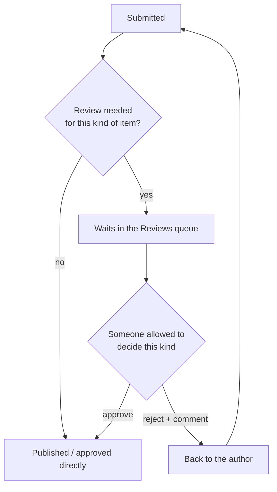

# Review flow

The one approval flow of the site. Everything that waits for someone's approval goes through it and is decided in the **Reviews** section of the admin area. Roles: [[scopes-and-roles]].

| What | Needs review when | Who decides |
|---|---|---|
| Notes, articles, [[event-proposals]] | it is public and the author is below coordinator of its scope | coordinators, admins and moderators of a scope **above** it |
| [[jobs]] | the poster does not manage the job's scope | admins, moderators and representatives of the job's scope **or above** |
| [[elections]] applications | always | admins, moderators and representatives of the election's scope **or above** |
| [[qualifications]] claims | always (QR codes are approved at once instead) | admins, moderators and representatives of the root |

Platform admins may always decide; nobody decides their own submission.

## Rules
- **Request email:** for content, the coordinators of the nearest scope above that has any; for the other kinds, the managers of the nearest scope (starting with the item's own) that has any; the platform admins when nobody qualifies. It cannot be turned off.
- **Decision email:** the author is told either way. Job posters hear about an approval through the job's own email, which they may turn off; rejections always come from the review flow.
- A rejection needs a comment. The author sees it (on the item's admin page, in "My submissions", next to their job listing or application).
- While waiting, content is invisible except to its author and its reviewers, who can preview it (a pending job listing too).
- Answers that come with a submission (an event proposal form, an election application's motivation) are shown to the reviewers in the queue.
- After the decision, the owning feature does its part (publish the event, approve the listing, grant the qualification) in the background, retried until it succeeds ([[background-jobs]]).
- An item deleted while waiting disappears from the queue.
- Content edits after an approval are not reviewed again; a rejected job listing goes back to review when its poster edits it.

## Decisions
- 2026-11: one review flow for content, jobs, election applications and qualification claims (before, each module had its own approve/reject buttons). Each kind keeps its earlier rule of who decides; the queue, comments, emails and history are now the same everywhere.
- Content needs approval from **above** (it travels up to the parents' pages); jobs, applications and claims are decided by the scope's own managers, as before.
- Features never decide for themselves whether review is needed; they declare their rule and core applies it.
