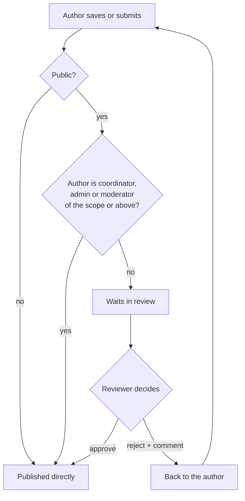

# Review flow

Public content from people below coordinator level is approved by someone higher up before the public sees it. Used by notes, articles and [[event-proposals]]. Roles: [[scopes-and-roles]].

## Does it need review?

## Who reviews
- **Gets the request email:** the coordinators of the nearest scope above that has any; if there are none above, the platform admins. This email can't be turned off.
- **May decide:** coordinators, admins and moderators of any scope **above** the item's scope, and platform admins.
- **Never:** the author themselves, or the representatives of the item's own scope.
- The author gets an email either way. The queue is the Reviews section in the admin area.

## Rules
- While waiting, the item is invisible: not listed, not found by search, its address answers "not found". Only the author and the reviewers can preview it.
- After a rejection, the author edits and saves (an event: submits again), which sends it back to review.
- Edits to approved content are published directly.
- Approval and rejection trigger follow-up work in the owning feature (publish the event, post an announcement). It runs in the background and is retried until it succeeds ([[background-jobs]]).

## Decisions
- One review rule for the whole site: features never decide for themselves whether review is needed.
