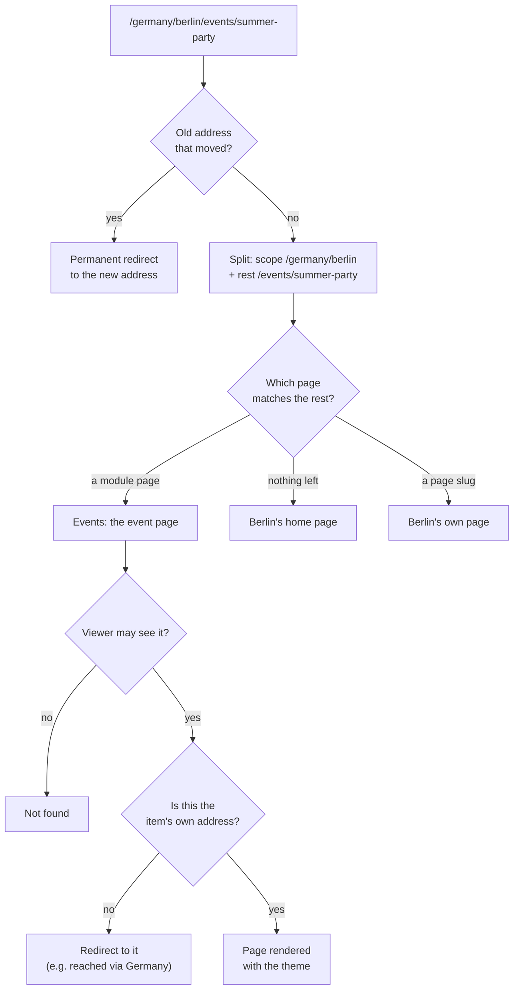

# Addresses and pages

Every item has exactly one address, and it shows the scope it belongs to ([[scopes-and-roles]]): `/germany/berlin/events/summer-party`.

## How an address is answered

Who may see what: [[visibility]].

## Rules
- **One address per item**, under the scope that owns it. Reaching it any other way redirects there.
- **Moving or renaming** a scope or a page records the old address, which keeps redirecting.
- **Links are stored as references, not addresses.** A menu entry, a link in an article or in an email points to "event 42" or "the Berlin scope"; the current address is filled in when the page is shown. Renames never break links.
- Page slugs and scope names never collide, so `/germany/berlin/about` is always unambiguous.
- The admin area lives at `/admin/<scope>` (e.g. `/admin/germany.berlin`) and shows what the viewer's role on that scope allows.

## Decisions
- 2026-10: addresses follow the scope tree; links are stored as references and resolved on display, so a moved chapter breaks nothing (#121).
