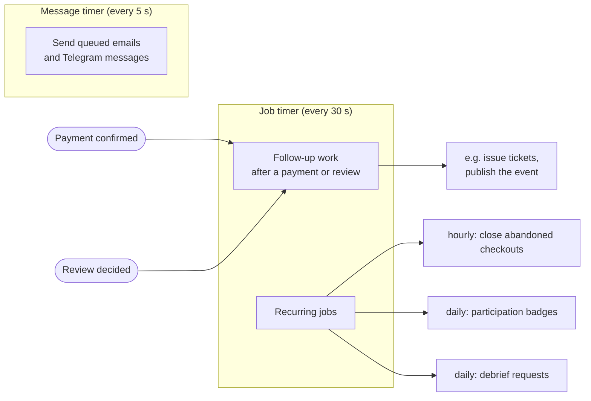

# Background jobs

Work that must not happen while a visitor waits, or must happen without a visitor at all.

There are no separate worker processes. The work is first **written to the database as a queue entry** (in the same step that caused it), and **two timers inside the web server** pick it up: one every 5 seconds for messages, one every 30 seconds for everything else. Because the queue is in the database, nothing is lost when the server restarts, and failures can be retried and shown to admins.

## Rules
- **Follow-up work** ("this order is paid, issue the tickets", "this event was approved, publish it") is queued and run in the background. It is **retried until it succeeds**, so every such step is written to be safe to repeat.
- **Recurring jobs** run at most once per interval, even across restarts or several servers. A failed run is retried after 1, 2, 4 … minutes.
- Platform admins see failing jobs and messages under Notifications in the admin area, with "Run now" / "Retry now".
- Recurring jobs of a switched-off module don't run; follow-up work for payments and reviews still does ([[application-structure]]).
- Emails are covered in [[notifications]].

## Decisions
- Queue and retry instead of doing the work during the request: a crash or a slow service never loses a paid order or a decision.
- Timers in the web server instead of a separate worker service: one thing to deploy, at the cost of a delay of up to 30 seconds. Two servers never run the same recurring job twice, because each run is claimed in the database first.
