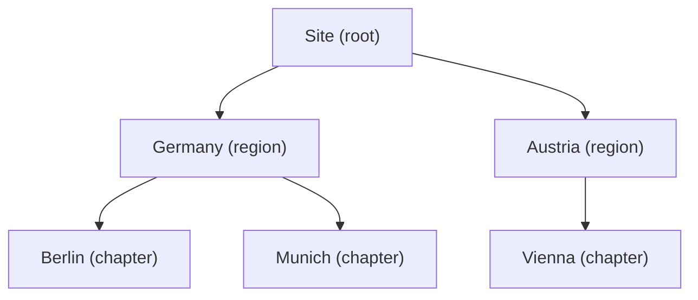
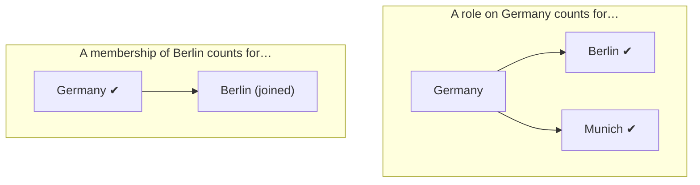

# Scopes and roles

The organisation is **one tree of scopes**. The whole site is the root; below it are regions, below those chapters (the levels are a setting per installation). Every event, note, article, page or job belongs to exactly one scope. Its address shows where it lives: `/germany/berlin/events/summer-party`.

## Roles flow down, membership flows up

- A **role** is given on one scope and applies there **and in every scope below it**. An admin of Germany is an admin of Berlin and Munich.
- A **membership** is held in one chapter and counts **upward**: a Berlin member is also a member of Germany and of the site. New users belong to the site only.

## The four roles

| Role | Can | Cannot |
|---|---|---|
| **Admin / Moderator** (identical) | Manage the scope and everything below. On the root: the whole platform (users, menus, tags, notifications, payments). | — |
| **Representative** | Manage their scope and below: events, notes, articles, pages, members, sub-scopes. | Publish public content without approval ([[review-flow]]); appoint anyone but other representatives. |
| **Coordinator** | Approve or reject public content from scopes below. | Manage anything: their admin area is the review queue only. |

- Nobody can take away their own role.
- **Organiser** is not a role. It is the person who created an event. Any representative or admin of that scope or above can edit the event too.

## How it is stored
The tree, the roles held on each scope and the memberships are three separate tables; users themselves carry no role.

## Decisions
- 2026-10: groups, regions and chapters became one tree, and the old site-wide user role was removed (#121). Every permission question is now "which role on which scope".
- Moving or renaming a scope keeps old addresses working through redirects ([[urls-and-pages]]).
