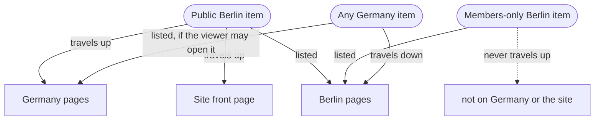

# Visibility

Every item belongs to a scope ([[scopes-and-roles]]). Notes, articles, events, pages and deals also have one of three visibilities; jobs and elections have none and count as public. Two questions follow from that: **who may open it**, and **on which scope pages it is listed**.

## Who may open an item

| The viewer is… | public | members | representatives |
|---|:-:|:-:|:-:|
| a guest (not logged in) | ✔ | – | – |
| logged in, not a member | ✔ | – | – |
| member of the item's scope **or a scope below it** | ✔ | ✔ | – |
| holds any role on the item's scope **or a scope above it** | ✔ | ✔ | ✔ |

Example: a members-only event of **Germany** can be opened by members of Germany, Berlin and Munich (membership counts upward) and by role holders of Germany and the site. A members-only event of **Berlin** cannot be opened by a Munich member.

## Where an item is listed

A scope's pages (news, events, home) list:
- its **own** items and its **parents'** items, each as far as the viewer may open them, and
- the **public** items of scopes **below** it.

So public content **travels up** to the site's front page, and everything **travels down** to the chapters below, but members-only content never travels up.

## Who may choose which visibility
- Posts and events are written in the admin area, so their authors always hold a role; they may choose all three. (The rule also covers authors without a role, who could only choose members or representatives.)
- Public content by someone below coordinator level waits for approval ([[review-flow]]); until then only the author and the reviewers can see it.

## Decisions
- One rule for every listing on the site, so no page decides visibility on its own.
- Public content is approved before it travels up, because a chapter's public post appears on the site's front page.
