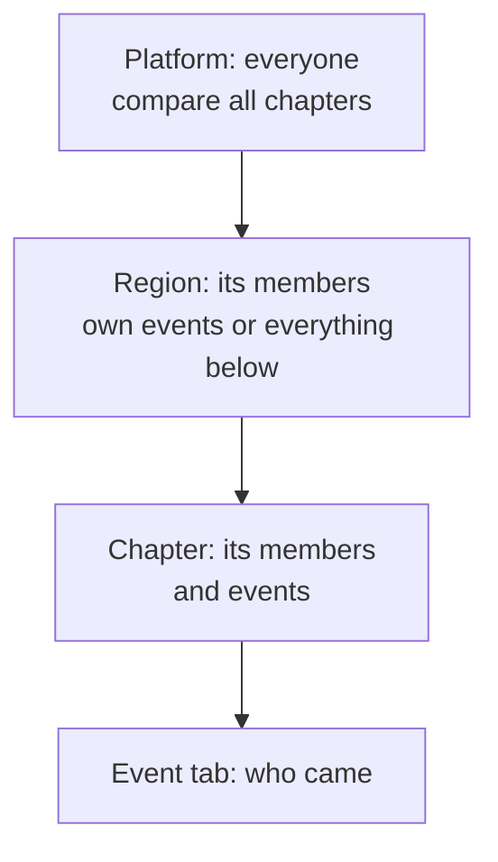

# Statistics

Who the members are, whether they come to events (and whom we have lost), as counts. Three levels: the whole site (root), any scope below it (a region, a chapter) and one event. Each scope shows its own events or, with a switch, everything below it, and can compare the chapters below.

## Where
- **Statistics** in the admin area of every scope ([[admin-area]]), for anyone with a managing role there.
- The **Statistics** tab of an event in the events admin ([[events]]).
- Modules add their own section to the scope page (the events module adds events), and can add a breakdown of people wherever people are counted (the qualifications module adds "by qualification").

## What a scope shows
- Members and new members in the last 30 days.
- New members and published notes and articles per month, the last 12 months.
- Who the members are: birth period, gender, membership tier ([[membership-tiers]]) and where they live (country and city).
- By qualification ([[qualifications]]): how many members hold each one, and how many hold none. With one qualification per batch ("Graduate 2019", "Graduate 2020") this is the cohort breakdown.
- **How engaged are the members?** The scope's members as core, regular, occasional, lost, new or never came (see *Engagement* below); which events they come to: only chapter events, only global events, both, none; and how: only in person, only online, both, none.
- **Only this level / including everything below:** a switch for the events part. "Only this level" counts the scope's own events (on the platform: the global events; on Germany: events Germany organises itself); "including everything below" adds every scope below. Pages open on this level, the platform page on everything. Members always count with everything below, since membership counts upward. The choice is in the address, so a view can be linked.
- **Compare chapters:** a button that ranks the scopes below by people who came in the last 12 months, with members, events and core or regular members, each linking to its own statistics page. By default the lowest scopes at any depth (every chapter, with its region next to it); "one level below" ranks the scopes directly below instead (on the platform: the regions).
- Events of the scope and below: events and people who came per month, tickets not used, how often people came (once, 2 to 4 times, 5 or more), who came in the last 12 months, where they live and from which chapter.

## What an event shows
- From RSVP to the door: said yes (maybe, no), tickets issued and for how many people, people who came, tickets not used once it is over.
- With whom: per order, came alone, with one more person, or as a group of 3 or more; companions without an account.
- By qualification, as for members.
- How engaged the people who came were before this event: first event, new, came back after being lost, occasional, regular, core.
- Where the people who came live: country and city, and from how many countries. Useful for international events.
- Birth period, gender, tier, and home chapter (this chapter, another chapter, none; not on the root, where everyone belongs).
- Tickets sold and revenue per ticket type (paid orders).

## Rules
- **Nobody is shown individually.** Only counts leave the server. In the home-chapter breakdown and the module breakdowns (e.g. qualifications) a group of 1 to 4 people reads "fewer than 5"; when exactly one group would be hidden, the next smallest is hidden too, so it cannot be worked out from the total.
- **Birth period, gender and membership** are shown with exact counts, small groups included: the period is already coarse, and the pages are for the scope's managers only.
- **Places** (country, city) are named only with 5 or more people; smaller ones are merged into "Other (N places)", so a place with one or two people is never named. "Other", "not given" and the number of different countries name no place, so they are shown as they are.
- Plain counts that organisers already see in the attendance list (tickets, orders, party sizes) are shown as they are.
- **Member of a scope** = member of it or of a scope below it, since the first join ([[scopes-and-roles]]). On the root: every account.
- **Engagement** is measured against the events a person could have attended: those of their chapters and the chapters above, global events, and any event they did attend, since they joined. Of the last 12 of those:
  - **core** = came to at least half,
  - **regular** = at least a quarter,
  - **occasional** = less,
  - **lost** = none, but came to an event before,
  - **new** = came, but has had fewer than 4 events to attend so far: too early to rate,
  - **never** = never came.

  So it follows each chapter's own rhythm: 12 events can be three years in a small chapter and six months in a busy one. The number of events, both thresholds and the minimum for "new" are settings of the site. Logins do not count. On the event tab it is measured just before the event.
- **Global events** are the root's events; **chapter events** are those of any other scope.
- **Took part** = on a scanned ticket (in-person and hybrid events). Online events have no check-in, so there a ticket or a "yes" counts.
- **Came** = on a scanned ticket. A scan checks in everyone on the ticket ([[rsvp-and-check-in]]), so companions count as having come with the buyer. Birth period, gender, tier and home chapter only count people with an account.
- **By qualification** counts approved qualifications only; someone with two counts in both groups.

## Decisions
- 2026-11: three levels (site, chapter, event) in the admin area. No page views or visitor tracking in the CMS: that is left to a third-party tool.
- 2026-11: engagement is a share of the events a person could attend, not fixed months or years, so it fits small and busy chapters alike; the score is only counted, never shown or stored per person (no profiling). Newcomers are "new" until they have had a few events to attend, so one event does not make anyone core.
- 2026-11: activity means coming to events, not logging in: what matters is whether members take part, whom we lost, and who only comes locally or only globally.
- 2026-11: monthly numbers as columns (time left to right), shares of a whole (engagement, chapter or global, in person or online, home chapter, party size) as one stacked bar with numbers, named groups as bar lists. No pies, no second scale.
- 2026-11: small groups hidden from 5 where a group says something about a person beyond the profile (home chapter, module breakdowns such as qualifications); birth period, gender and membership are shown exactly (see below).
- 2026-11: "where they live" is the country and city of residence people give at sign-up. Nationality is not asked; if a community wants it, it belongs in its onboarding form.
- 2026-11: cohorts (batch, graduation year) are one qualification per batch, grouped by qualification; no separate cohort field. A group field for qualification types (all graduates, periods) only if the list gets too long.
- 2026-11: gender and membership with exact counts too: gender is no secret to anyone who was there, and the statistics are only for the scope's managers.
- 2026-11: people are counted by the birth period they gave ([[user-requirements]]), not by age; the periods that occur are listed, oldest first, with exact counts: a period of 5 or 10 years is anonymous enough, so small groups are not hidden there.
- 2026-11: later, not now: a +1 on free-event RSVPs and a standard feedback email after events.
- **Open:** online events count a ticket or a "yes" as taking part until there is a way to check who actually joined (#137).
- **Open:** the country is stored as text from the address lookup; it should become a country code, shown in the site's language (#138).
- **Open:** add how long people have been members.
