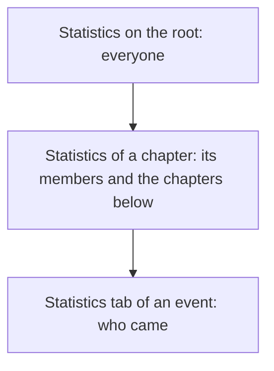

# Statistics

Who the members are, whether they come to events (and whom we have lost), as counts. Three levels: the whole site (root), a chapter (any scope, counting the scopes below it) and one event.

## Where
- **Statistics** in the admin area of every scope ([[admin-area]]), for anyone with a managing role there.
- The **Statistics** tab of an event in the events admin ([[events]]).
- Modules add their own section to the scope page (the events module adds events).

## What a scope shows
- Members and new members in the last 30 days.
- New members and published notes and articles per month, the last 12 months.
- Who the members are: age group, gender, membership tier ([[membership-tiers]]) and where they live.
- **Do members come to events?** The scope's members, at any event anywhere: active (came in the last 6 months), lost (came before, not in the last 6 months), never came; the last time they came (3, 6, 12 months, longer ago, never); which events they come to: only chapter events, only global events, both, none; and how: only in person, only online, both, none.
- Events of the scope and below: events and people who came per month, tickets not used, how often people came (once, 2 to 4 times, 5 or more), who came in the last 12 months and from which chapter.

## What an event shows
- From RSVP to the door: said yes (maybe, no), tickets issued and for how many people, people who came, tickets not used once it is over.
- With whom: per order, came alone, with one more person, or as a group of 3 or more; companions without an account.
- First event or came before, age group, gender, tier, and home chapter (this chapter, another chapter, none; not on the root, where everyone belongs).
- Tickets sold and revenue per ticket type (paid orders).

## Rules
- **Nobody is shown individually.** Only counts leave the server. In breakdowns of people (age, gender, tier, place, home chapter) a group of 1 to 4 people reads "fewer than 5"; when exactly one group would be hidden, the next smallest is hidden too, so it cannot be worked out from the total.
- Plain counts that organisers already see in the attendance list (tickets, orders, party sizes) are shown as they are.
- **Member of a scope** = member of it or of a scope below it, since the first join ([[scopes-and-roles]]). On the root: every account.
- **Active** = came to an event in the last 6 months; **lost** = came to one before, but not in the last 6 months. Logins do not count.
- **Global events** are the root's events; **chapter events** are those of any other scope.
- **Took part** = on a scanned ticket (in-person and hybrid events). Online events have no check-in, so there a ticket or a "yes" counts.
- **Came** = on a scanned ticket. A scan checks in everyone on the ticket ([[rsvp-and-check-in]]), so companions count as having come with the buyer. Age, gender, tier and home chapter only count people with an account.
- **Came before** = was on a scanned ticket of an event that started earlier.

## Decisions
- 2026-11: three levels (site, chapter, event) in the admin area. No page views or visitor tracking in the CMS: that is left to a third-party tool.
- 2026-11: activity means coming to events, not logging in: what matters is whether members take part, whom we lost, and who only comes locally or only globally.
- 2026-11: small groups hidden from 5, so the page can go to every chapter's managers without exposing anyone's private profile fields.
- 2026-11: later, not now: a +1 on free-event RSVPs, a standard feedback email after events, and verifying who actually joined an online event (issue #137).
