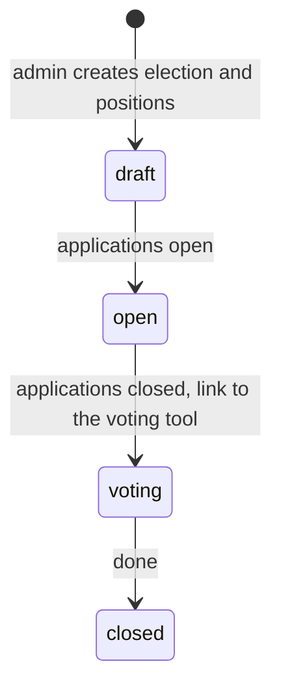

# Elections

Board elections: admins open an election with positions, members apply as candidates, admins approve candidates, and voting happens on an external voting tool.

## Rules
- Election pages need a login. A draft election is visible to admins only.
- **Applying:** while an election is open, a logged-in member applies for a position with three short answers (why, experience, goals). An election can require a membership tier ([[membership-tiers]]); without it, applying is refused.
- A position can state how many candidates it takes.
- Every application is decided in the **Reviews** queue ([[review-flow]]) by an admin, moderator or representative of the election's scope or above, who sees the three answers there. The decision comment is kept on the application; only the applicant sees it. The applicant is emailed either way.
- Approved candidates are shown on the election page. People see their own applications and their status.
- The actual vote happens outside the CMS, through the voting link of the election.
- Admins of any scope run elections for their scope.

## Decisions
- Voting itself is left to a dedicated tool; the CMS handles candidates and information.
- 2026-11: applications moved from the election's admin page to the site-wide [[review-flow]], keeping who decides.
- 2026-11: elected candidates get no board badge automatically; this is not wanted, admins add it by hand ([[badges]]).
