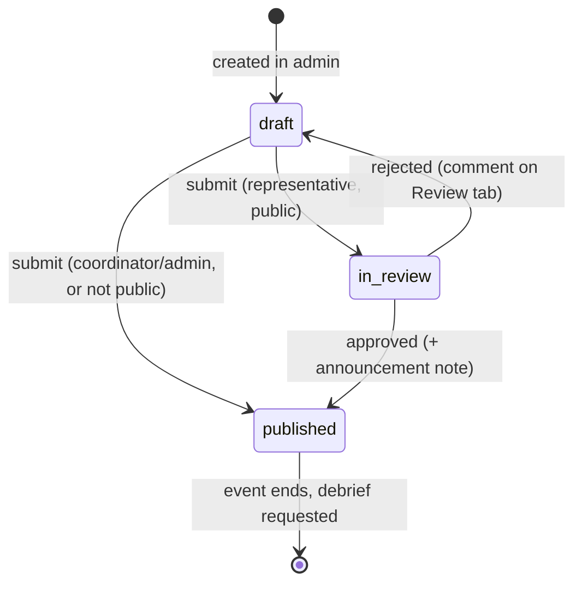

# Event proposals

There is **one way to create an event**: in the admin area. Every new event starts as a **draft**. The organiser (its creator, see [[scopes-and-roles]]) then submits it on the event's Review tab. Whether that publishes it directly or makes it a *proposal* waiting for approval depends only on who submits it and the event's visibility. After the event, the organiser is asked for a debrief.

## Rules
- Status: `draft` → (`in_review`) → `published`. Only a draft can be submitted; a rejection returns it to `draft`.
- Published directly: a coordinator, admin or moderator of the scope or above, or a non-public event ([[visibility]]). Otherwise (a representative's public event) it goes to [[review-flow]]. The events module never decides this itself.
- The scope's active `events.proposal` form (if any) is filled in on submit; its answers are stored with the review.
- On approval, "Post announcement" (on by default) creates a note about the event, authored by the organiser.
- Debrief: a daily schedule asks the organiser of an ended event (up to 30 days ago) to fill in the active `events.debrief` form, once, plus one reminder a week later ([[notifications]]). After that it shows as overdue in the admin list. Nothing is blocked.

## Data
- `events(id, scopeId, userId = organiser, status, visibility, announceOnApproval, announcementNoteId, debriefRequestedAt, …)`
- The review is a `reviews` row with ref `events:event:<id>`; proposal and debrief answers are `form_results` with the same ref.

## Decisions
- 2026-10: proposals reuse core reviews and forms instead of an approval flow of their own (#88).
