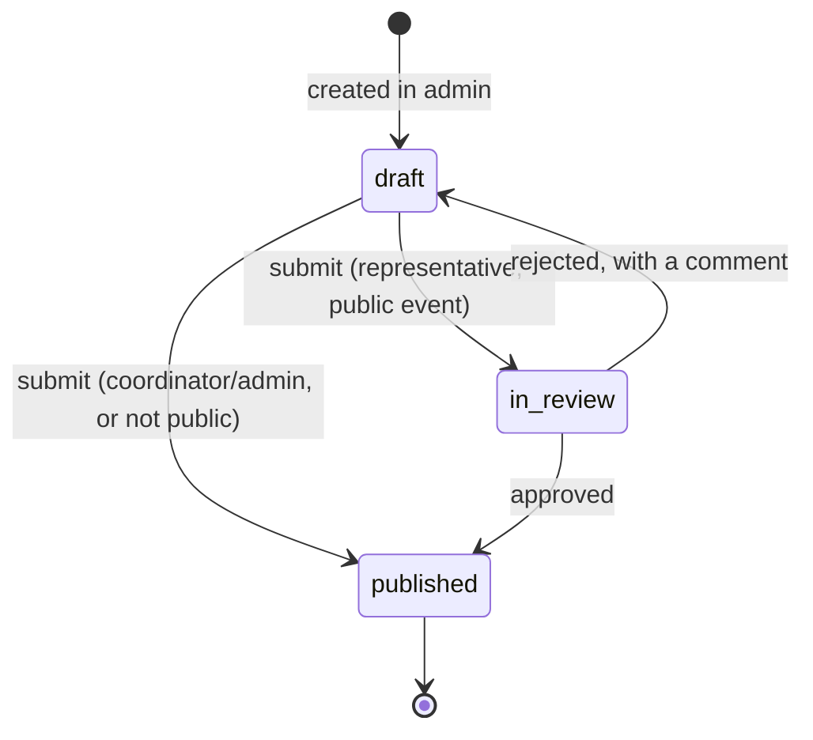
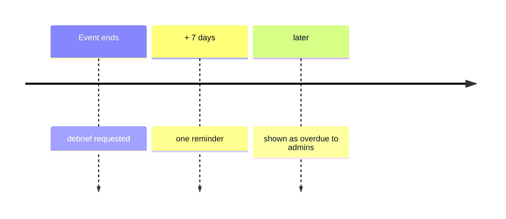

# Event proposals

There is **one way to create an event**: in the admin area of a scope. Every new event starts as a **draft**, visible only in the admin area. The organiser (whoever created it, see [[scopes-and-roles]]) submits it on the event's Review tab. Whether that publishes it straight away or turns it into a *proposal* waiting for approval depends only on who submits it and on its visibility ([[review-flow]]).

## Rules
- Only a draft can be submitted.
- If the scope has a **proposal form**, the organiser fills it in when submitting; the reviewer sees the answers.
- On approval, the event is published and, unless the organiser unticked "Post announcement", a short note announcing it is posted in the organiser's name.
- **Debrief:** after the event, the organiser is asked to fill in the scope's debrief form, if there is one: once by email, and once more a week later ([[notifications]]). After that it shows as overdue in the admin list. Nothing is blocked if it stays empty. Events that ended more than 30 days before this started are not asked.

## How it is stored
The event itself carries its status, its organiser and whether to announce it. The review and the form answers are stored by core and point back to the event.

## Decisions
- 2026-10: proposals reuse the site-wide review flow and forms instead of an approval flow of their own (#88).
