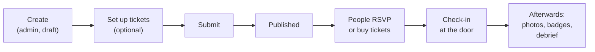

# Events

The events module lets every scope ([[scopes-and-roles]]) organise events: in person, online or both, free or paid, open to everyone or members only ([[visibility]]). It is optional: an installation can switch it off ([[application-structure]]).

## An event's life

| Step | What happens | Details |
|---|---|---|
| Create & publish | Created as a draft in a scope's admin area; published directly or after approval. | [[event-proposals]] |
| Tickets | Optional. Places come in capacity pools, shared by ticket types with a price, a per-person limit and how many people one ticket covers. | [[ticket-checkout]] |
| RSVP | "Going / maybe / not going", no payment, no capacity. Buying a ticket sets "going" automatically. | [[rsvp-and-check-in]] |
| Buy | Questions (food, photo consent), attendee names, then payment. A €0 ticket goes through the same steps and is issued at once. | [[ticket-checkout]] |
| Free tickets by hand | Admins can issue a free ticket to someone's email address, e.g. for guests or press. | [[rsvp-and-check-in]] |
| Check-in | Each ticket is a QR code under "My tickets"; scanned at the door with a phone, once only. | [[rsvp-and-check-in]] |
| Updates | Notes and articles about the event appear on its page. | [[notes-and-articles]] |
| Afterwards | Photos visible only to people who were checked in; participation badges awarded daily; the organiser is asked for a debrief. | [[rsvp-and-check-in]], [[badges]], [[event-proposals]] |

## Where events show up
- **Public:** the Events page of each scope (its own and its parents' events, plus public events from scopes below: [[visibility]]), the event's own page, page-builder blocks, the scope's home page, the sitemap (public events only), a calendar file in the ticket email.
- **Personal:** "My tickets" in the user menu, and the food preference / photo consent settings in the profile.
- **Admin:** the Events section in every scope's admin area, including the root. Per event: details, tickets, orders, participants, attendance, scan, free tickets, photos, updates and review.

## Rules that hold everywhere
- Every event belongs to one scope and has one address under it ([[urls-and-pages]]).
- Anyone with a managing role on the event's scope or above may edit it, not only the organiser.
- The food and photo answers are private; organisers see them only in the participant list.
- Messages (ticket email, sale alert, debrief) go through [[notifications]].

## Also see
The step-by-step guide for admins with screenshots: [event and ticketing flow](../../../../docs/event-ticketing-flow.md).
