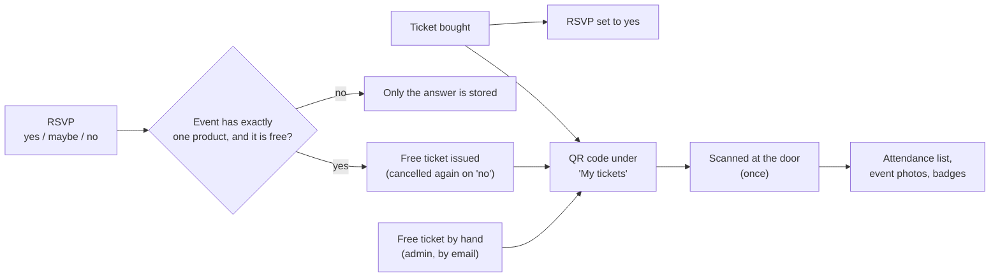

# RSVP and check-in

How people say they come, and how they are let in. Part of [[events]].

## Rules
- **RSVP** (going / maybe / not going) needs a login and is free; it says nothing about capacity.
- If an event has exactly one product and it costs nothing, answering "yes" or "maybe" issues a free ticket automatically, and "no" cancels it again (unless it was already scanned).
- Buying a ticket ([[ticket-checkout]]) sets the RSVP to "going".
- **Free tickets by hand:** admins can send a free ticket to any email address (guests, speakers, press); an account is created for that address if needed.
- **Check-in:** a managing role scans the QR code with a phone. A ticket can be scanned only once; a second scan shows when it was used.
- Being checked in unlocks the event's **photos** for that person and counts towards participation [[badges]].
- Organisers see participants (with food preference and photo consent, see [[user-requirements]]), the attendance list and all tickets in the event's admin tabs.

## Decisions
- RSVP and tickets are separate, so a free meetup needs no checkout, while a ticketed event still counts real places.
