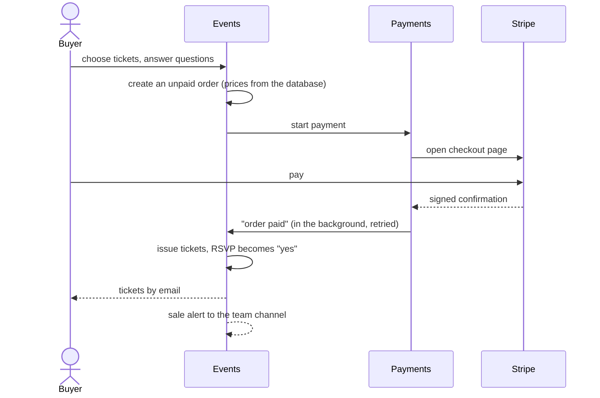
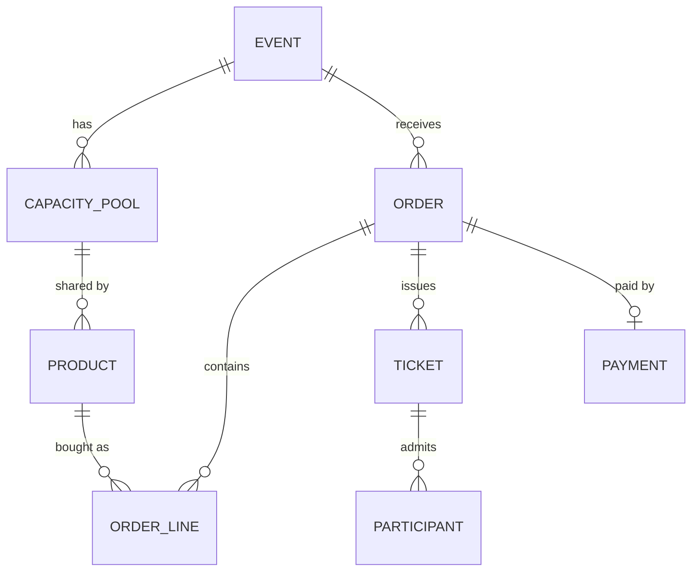

# Ticket checkout

A buyer picks tickets for an event, answers a few questions, pays through [[payments]] and gets the tickets by email.

## Rules
- Before buying, the buyer states their **food preference** and **photo consent**. The answers are private: organisers see them only in the participant list.
- **Places are not reserved during checkout.** Only paid orders count against capacity.
- **Paid:** the order is marked paid, tickets are issued (never twice), the buyer's RSVP becomes "yes", the buyer gets the tickets and the team channel gets a sale alert ([[notifications]]).
- **Not paid** (declined or expired): the order is canceled.
- **Late payment (rare safety net):** if a payment still arrives for an order that was already canceled, the order is revived and the tickets are issued anyway, even if the event is full by then, because the money was taken.
- **Refunded:** tickets not yet scanned at the door are canceled and their places freed; scanned tickets stay.

## How it is stored

- A **capacity pool** is a number of places shared by several products (e.g. "Early bird" and "Regular" both use the 100 seats). Why: see [why inventory groups](../../../../docs/event-tickets.md).
- A **ticket** is what gets scanned at the door; a group ticket admits several participants.

## Decisions
- 2026-10: tickets use the shared payment system instead of their own Stripe integration.
- No reservation during checkout, so unpaid checkouts never block places. **Consequence, open:** two buyers paying for the last places at the same time, or a bank transfer confirming days later, can push an event over capacity; nothing refunds or flags it yet (see #74).
