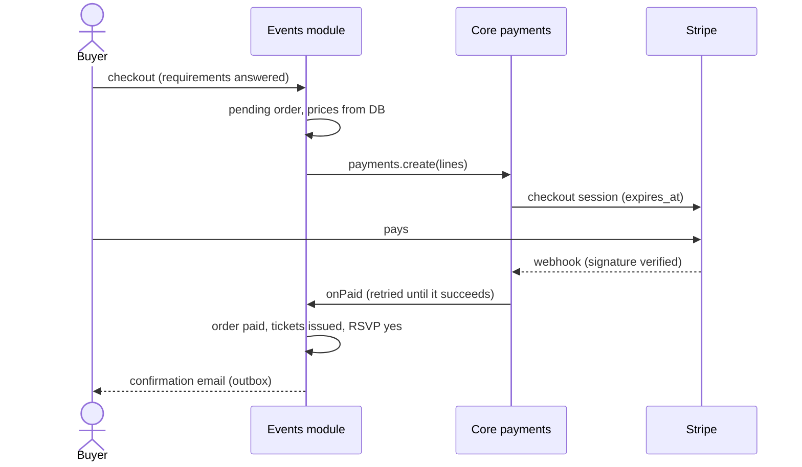
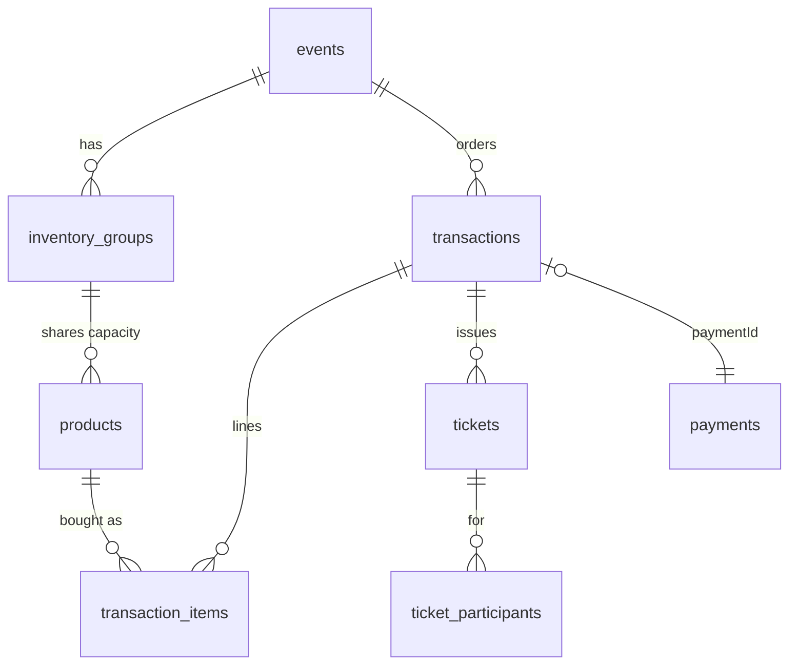

# Ticket checkout

A buyer picks tickets for an event, answers the checkout questions, pays through [[payments]] and gets the tickets by email.

## Rules
- Before buying, the buyer completes the `event.checkout` requirements: food preference and photo consent. Answers are private; organisers see them only in the participant list.
- Prices always come from the products in the DB, never from the request.
- A checkout creates a pending order (`transactions`). **Nothing is reserved until payment**: capacity counts paid orders only.
- Paid: the order is marked paid, tickets are issued (once, even on retry), the buyer's RSVP becomes "yes", the buyer gets a confirmation email and the team's Telegram channel gets a sale alert (both through [[notifications]]).
- Late payment (safety net, rare): checkouts expire at Stripe and here at the same time (see [[payments]]), so normally no payment can arrive for a canceled order. If one still does (e.g. a race at the moment of expiry), the order is revived and the tickets are issued anyway, even if the event is full by then, because the money was already taken.
- Failed or expired: the pending order is canceled.
- Refunded: unscanned tickets are deleted and their places freed; scanned tickets stay.

## Data
- `inventory_groups(eventId, name, maxCapacity, needsTicket, salesStartDate, salesEndDate)`: a shared pool of places (capacity is counted here).
- `products(eventId, inventoryGroupId, name, price, maxQuantity, participantCapacity, soldQuantity)`: what can be bought; `soldQuantity` counts paid orders.
- `transactions(eventId, userId, status, totalAmount, paymentId, participants)` + `transaction_items(productId, quantity, unitPrice)`: the order.
- `tickets(transactionId, productId, eventId, buyerId, qrCodeUuid, scannedAt)` + `ticket_participants`: what is scanned at the door.

- Requirement answers: `user_requirements` (core). The payment itself: see [[payments]].

## Decisions
- 2026-10: tickets go through the generic core payments instead of an own Stripe integration.
- No reservation during checkout: no capacity is held by unpaid checkouts. Consequence: two buyers paying for the last places at the same time can both get them.
