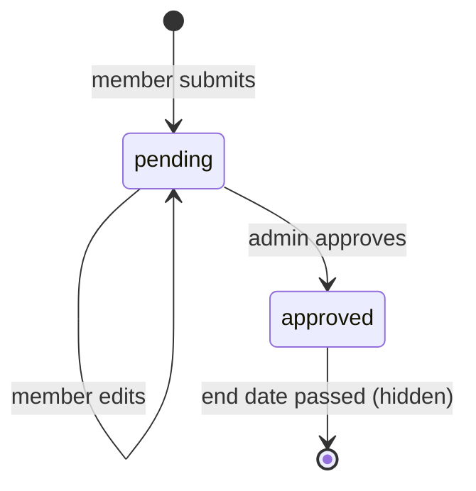

# Jobs

A job board for members: anyone logged in can suggest a job listing; it goes live after an admin approves it.

## Rules
- The job board is for logged-in people only.
- A listing belongs to a scope (the one it was submitted from, otherwise the whole site) and is listed there, above and below it.
- A listing runs for **at most 30 days**.
- The member who submitted it can edit it only while it is pending; after approval only admins can change it. Members see their own submissions and their status.
- Admins of a scope approve, edit and delete the listings of their scope and below.
- Text is plain formatted text, no images.

## Decisions
- **Open:** jobs have their own approval (pending → approved by an admin) instead of the site-wide [[review-flow]], so the review rules (who decides, notifications) do not apply here.
