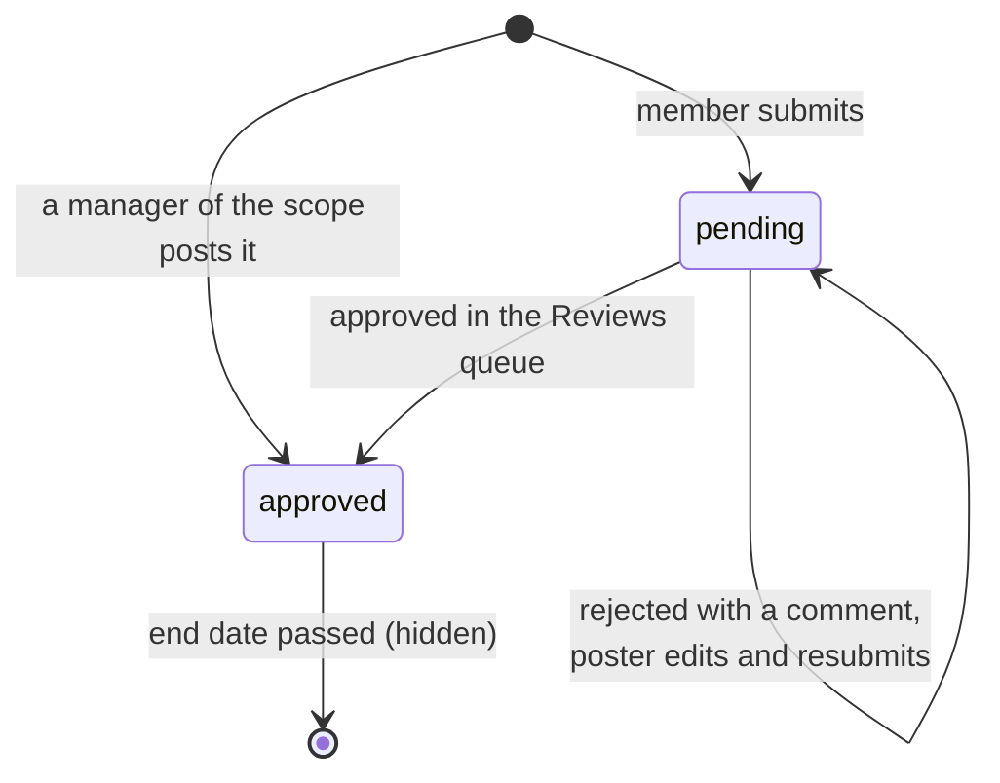

# Jobs

A job board for members: anyone logged in can suggest a job listing; it goes live after it is approved in the Reviews queue ([[review-flow]]).

## Rules
- The job board is for logged-in people only.
- A listing belongs to a scope (the one it was submitted from, otherwise the whole site) and is listed there, above and below it.
- A listing runs for **at most 30 days**.
- A listing is approved or rejected in the **Reviews** queue by an admin, moderator or representative of its scope or above. Coordinators don't decide jobs. Someone who manages the scope can post without review.
- The member who submitted it can edit it only while it is pending; after approval only admins can change it. Members see their own submissions, their status and a rejection comment; editing a rejected listing sends it back to review.
- Reviewers can open a pending listing from the queue to read it.
- On approval the poster gets the "job approved" email, which they can turn off; a rejection always comes by email.
- Admins of a scope edit and delete the listings of their scope and below.
- Text is plain formatted text, no images.

## Decisions
- 2026-11: approval moved from the jobs admin list to the site-wide [[review-flow]], keeping who decides (the scope's managers).
