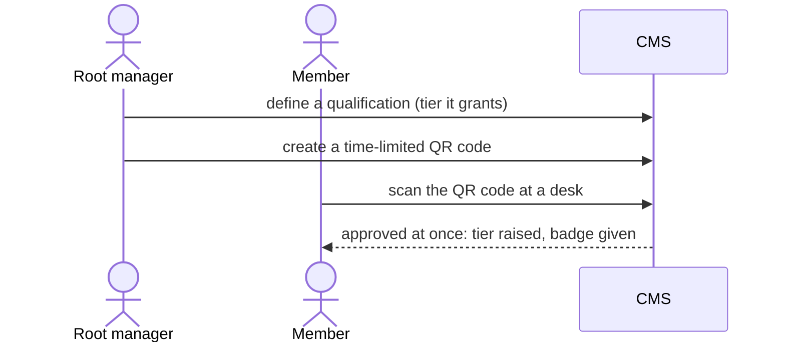

# Qualifications

A general way to verify members against a criterion (e.g. "is a student", "completed the training") and reward them: approval can raise their [[membership-tiers]] and give them a badge ([[badges]]).

## Rules
- Managed on the root only (qualifications are site-wide, not per scope), by anyone with a managing role there: admins, moderators **and representatives** of the root.
- A member has one claim per qualification: pending, approved or rejected.
- QR codes expire after the chosen number of hours and can be revoked. Scanning a valid one **approves the claim at once**, in the name of the admin who made the code: they vouched for it by handing it out.
- A pending claim is decided in the **Reviews** queue ([[review-flow]]) by the root's managers; a rejection keeps the reviewer's comment on the claim.
- Approval raises the tier if the qualification grants a higher one, never lowers it.

## Decisions
- QR codes for in-person checks (at an event or info desk) approve immediately; no second check.
- 2026-11: pending claims moved from the qualifications admin page to the site-wide [[review-flow]].
- **Open:** members cannot claim a qualification themselves yet; pending claims only come from demo data. If self-claims are added, they go through the review flow.
