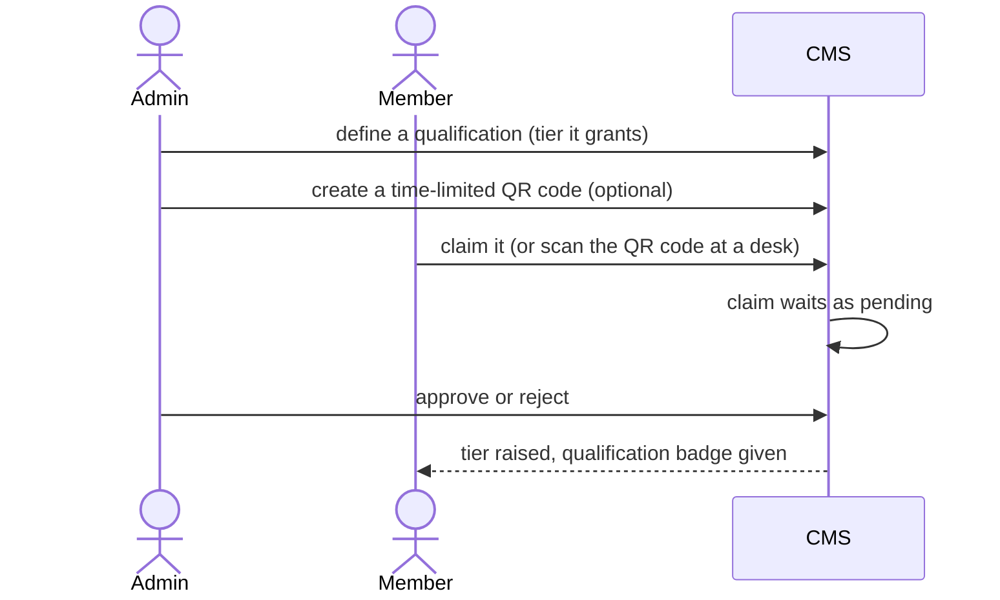

# Qualifications

A general way to verify members against a criterion (e.g. "is a student", "completed the training") and reward them: approval can raise their [[membership-tiers]] and give them a badge ([[badges]]).

## Rules
- Managed by platform admins only; qualifications are site-wide, not per scope.
- A member has one claim per qualification: pending, approved or rejected.
- QR codes expire after the chosen number of hours and can be revoked. Scanning one only creates a pending claim; it never approves by itself.
- Approval raises the tier if the qualification grants a higher one, never lowers it.

## Decisions
- QR codes for in-person checks (at an event or info desk), with an admin still approving each claim.
