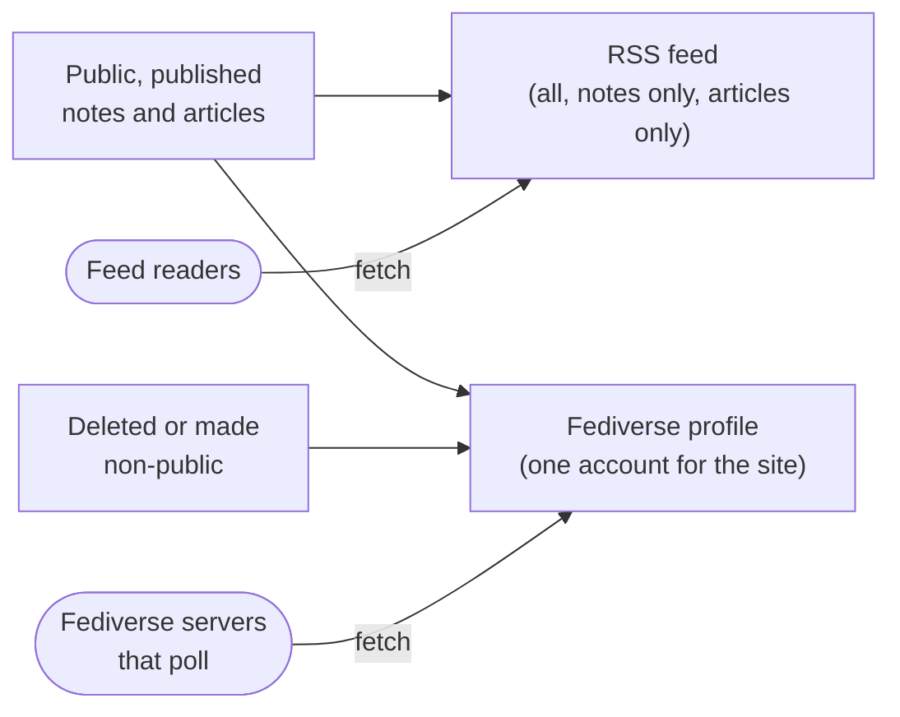

# Social web

Makes the site's public posts readable outside the site: an RSS feed and a Fediverse profile.

## Rules
- Only what a guest can see goes out: public, published notes and articles of the whole site ([[notes-and-articles]], [[visibility]]).
- RSS: one feed with everything, or only short notes, or only articles. A note has no title in the feed.
- The Fediverse profile is **read-only and pull-based**: other servers fetch its posts; it never sends anything and accepts no replies or follows.
- When a public post is deleted or made non-public, a deletion notice is published so copies elsewhere can be removed.
- The account name, summary, icon and update interval are settings of the installation.

## Decisions
- 2026-10: pull-only first (#1, #7). **Consequence:** common servers like Mastodon cannot follow the account, because that needs the site to push posts; full federation is open (#7).
